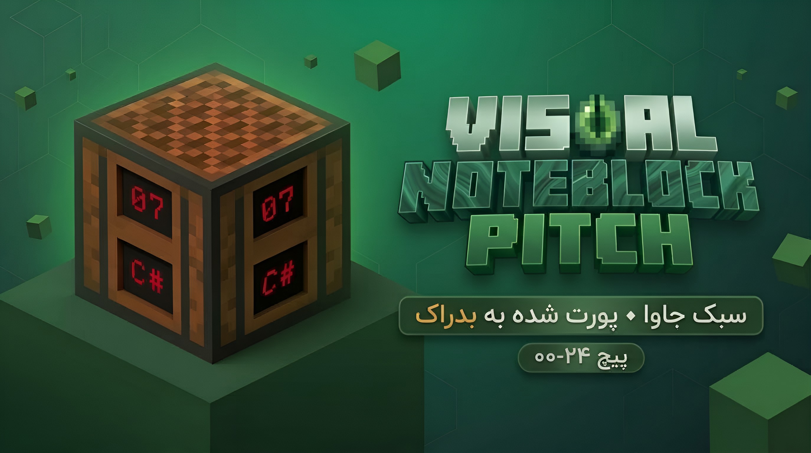
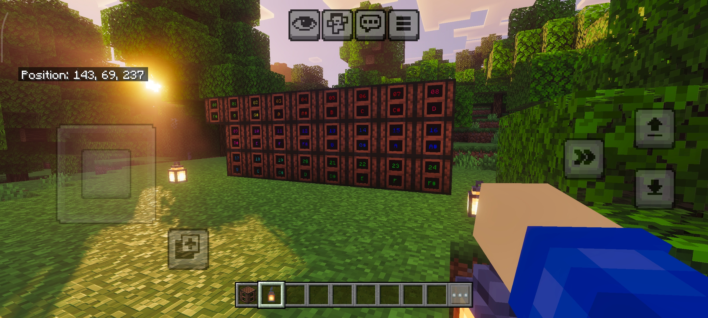
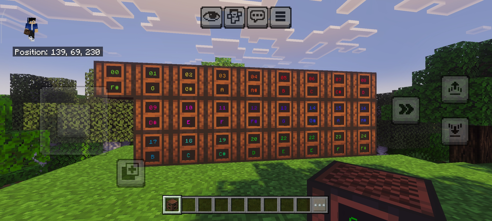
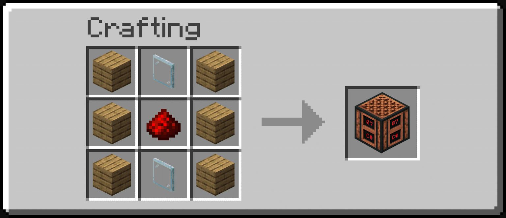
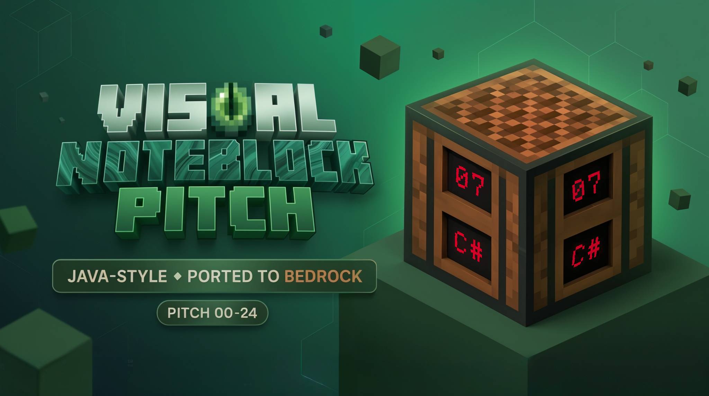

<details name="language" dir="ltr">
<summary> <a href="#!"></a> فارسی </summary>

<div dir="rtl">

# ویژوال نوت بلاک پیچ (Bedrock) | Visual Noteblock Pitch (Bedrock)

<p>
  
  
  <a href="CHANGELOG.md"></a>
  
  <a href="LICENSE"></a>
</p>

<p align="center">
  
</p>

---

## <a href="#!"></a> درباره پروژه

**Visual Noteblock Pitch (Bedrock)** در اصل یک پورت از پک ریسورس «Visual Noteblock Pitch» نسخه‌ی جاوا (Vanilla Tweaks) به بدراک است. هدف، انتقال نمایشگرهای گام نسخه‌ی جاوا بود؛ اما چون بدراک اجازه‌ی تغییر و دستکاری رفتار نوت‌بلاک وانیلا را نمی‌دهد، ابتدا پروژه‌ی پایه‌ی **NoteBlockClone** ساخته شد و سپس با فورک کردن آن، **Visual Noteblock Pitch (Bedrock)** شکل گرفت. نتیجه یک نوت‌بلاک با رفتار کاملاً وانیلاست که گام فعلی (۰۰ تا ۲۴) را روی چهار وجه جانبی با نمایشگرهای تورفته‌ی سه‌بعدی نشان می‌دهد.

همه چیز فقط با **API های رسمی و پایدار** (نسخه ۱٫۲۶+) پیاده‌سازی شده و **بدون هیچ Experiment ای** کار می‌کند.

### <a href="#!"></a> چرا این افزونه؟

- <a href="#!"></a> بدون نگاه‌کردن به دیباگ‌اسکرین، گام هر نوت بلاک را از هر جهت ببینید
- <a href="#!"></a> رفتار دقیقاً مثل نوت بلاک اصلی: ساز، رداستون، کوک، پارتیکل — بدون متن اضافه روی صفحه
- <a href="#!"></a> تعویض تکسچر فقط با Block Permutation — صفر خط کد برای نمایش

## <a href="#!"></a> اسکرین‌ شات‌ها

<p align="center">
  
  
</p>
<p align="center"><sub>نمای بلوک و متغیرهای تکسچر آن از دو زاویه</sub></p>

---

## <a href="#!"></a> ویژگی‌ها

### <a href="#!"></a> رفتار ۱۰۰٪ وانیلا

* پاسخ به **لبه صعودی** سیگنال رداستون (بدون صدا هنگام لود چانک)
* **۱۸ ساز** بر اساس بلوک زیرین — از جمله خانواده ترامپت مس (۴ مرحله اکسیداسیون) — خط‌به‌خط با مستندات minecraft.wiki
* کوک با کلیک: چرخه گام ۰ → ۲۴ با صدا + پارتیکل وانیلا — بدون هیچ متن اکشن‌باری
* سکوت کامل وقتی بالای بلوک هوا نیست — پخش صدای موب با سر‌ها (اسکلت، ویتر، زامبی، کریپر، اژدها، پیگلین)
* پارتیکل نُت وانیلا با رنگ طیف واقعی (متغیر `note_color` — فرمول سینوسی جاوا)
* کلیک بدون «بلوک شبح»، هدایت رداستون مثل بلوک معمولی، حرکت‌ناپذیر با پیستون

### <a href="#!"></a> نمایشگر سه‌بعدی گام

* ۲۵ تکسچر گام (۰۰ تا ۲۴) با معماری بصری پک جاوا
* نمایشگرهای **تورفته ۰٫۵ پیکسلی** (نظیر‌به‌نظیر نسخه جاوا) روی هر ۴ وجه جانبی
* قاب سوراخ‌دار + ۳۲ دیوار تونل (`#7F5038`) تا داخل بلوک هرگز دیده نشود
* تعویض نمایشگر فقط با ۲۴ Block Permutation روی استیت‌ها — بدون هیچ کد اسکریپتی

### <a href="#!"></a> سالم و پایدار

* فقط کامپوننت‌ها و هوک‌های **Stable** (بدون Experiment)
* تست خودکار: ۵۲ کلیک شبیه‌سازی‌شده، پیکربندی تکسچر=گام در تمام چرخه‌ها ✓

## <a href="#!"></a> نصب و استفاده

1. فایل دانلودشده‌ی `VisualNoteblockPitch (Bedrock) - V1.1.0 - 1.26+.mcaddon` را باز کنید — بازی هر دو پک را وارد می‌کند
2. در تنظیمات جهان، هر دو پک **Visual Noteblock Pitch (Behavior)** و **(Resources)** را فعال کنید — Experiments لازم نیست
3. بلوک را از تب **Items** بردارید یا با دستور بگیرید:

```text
/give @s notey:visual_noteblock_pitch
```

4. در بقا هم با **۶ تخته + ۲ شیشه (Glass Pane) + ۱ رداستون** ساخته می‌شود.
   - بدراک تگِ item برای همه‌ی رنگ‌های Glass Pane ندارد؛ برای هر رنگ یک رسپی هم‌الگو نصب می‌شود و خروجی همه یکی است.

<p align="center">
  
</p>
<p align="center"><sub>رسپی ساخت: ۶ تخته + ۲ شیشه + ۱ رداستون (نمایش با شیشه‌ی ساده)</sub></p>

---

## <a href="#!"></a> گام‌ها و نام نت‌ها

فرمول پیچ دقیقاً مثل وانیلاست: `2^((note-12)/12)`. هر کلیک یک شماره جلو می‌رود و بعد از ۲۴ به ۰۰ برمی‌گردد:

جدول کامل ۲۵ گام:

| گام | نت |
| --- | --- |
| 00 | F# |
| 01 | G |
| 02 | G# |
| 03 | A |
| 04 | A# |
| 05 | B |
| 06 | C |
| 07 | C# |
| 08 | D |
| 09 | D# |
| 10 | E |
| 11 | F |
| 12 | F# |
| 13 | G |
| 14 | G# |
| 15 | A |
| 16 | A# |
| 17 | B |
| 18 | C |
| 19 | C# |
| 20 | D |
| 21 | D# |
| 22 | E |
| 23 | F |
| 24 | F# |

ادان هم شماره‌ی گام و هم نام نت را روی بلوک نمایش می‌دهد.

<details>
  <summary style="font-weight: bold; font-size: 1.5em;">
    <a href="#!"></a> توضیحات بیشتر
  </summary>

## <a href="#!"></a> معماری پروژه

نمایشگرها بدون هیچ رندر سمت‌کلاینت اضافه‌ای ساخته شده‌اند — فقط کامپوننت‌های پایدار:

```text
minecraft:geometry (geometry.notey_visual_noteblock_pitch)
        ├─ قاب کامل (وجه بالا/پایین وانیلا + frame سوراخ‌دار در پهلوها)
        ├─ ۸ وجه نمایشگر تورفته (۰٫۵ px) با UV اشتراکی
        └─ ۳۲ دیوار تونل اتصال قاب به پنل‌ها
material_instances: up / down / side_frame / display_top / display_bottom / tunnel_wall
        ▼
۲۴ Permutation ← Query on block states (notey:octave × notey:semitone, pitch = octave×13 + semitone)
```

اسکریپت سمت سرور (Script API 2.0.0) فقط رفتار را کنترل می‌کند: کوک، سازها، لبه رداستون، پارتیکل — و چیزی را «قابل نمایش» حرکت نمی‌دهد.

## <a href="#!"></a> محدودیت‌های شناخته‌شده

* **لود چانک صدا نمی‌دهد:** `onRedstoneUpdate` هنگام لود چانک هم فایر می‌شود؛ ما عمداً اولین رویداد را فقط «ثبت» می‌کنیم (رفتار وانیلا هم همین است)
* **تشخیص ساز تقریبی است:** بازی API ای برای «متریال» ندارد؛ بلوک‌های ماد ممکن است پیش‌فرض (هارپ) شوند — تابع `getInstrument` قابل توسعه است
* **کامپوننت `minecraft:instrument_sound` عمداً استفاده نشده:** آن کامپوننت برای «بلوک‌های دیگر» است نه رفتار نوت بلاک؛ ما منطق را در اسکریپت پیاده کردیم که دقیق‌تر و بدون Experiment است
* **نسخه بازی:** نیازمند Minecraft Bedrock **26.0+** (موتور `1.26.x`)

## <a href="#!"></a> ساختار پروژه

```text
VisualNoteblockPitch (Bedrock)/
├── packs/
│   ├── VisualNoteblockPitch (Bedrock) BP/      # Behavior Pack
│   │   ├── manifest.json
│   │   ├── blocks/visual_noteblock_pitch.json    # definition + 24 permutations
│   │   ├── recipes/visual_noteblock_pitch*.json   # 6 planks + 2 glass panes + redstone (all colors)
│   │   └── scripts/main.js          # tuning, redstone, instruments, particles
│   └── VisualNoteblockPitch (Bedrock) RP/      # Resource Pack
│       ├── manifest.json
│       ├── models/blocks/visual_noteblock_pitch.geo.json
│       └── textures/blocks/         # vanilla faces + 25 pitches + frame + tunnel
├── docs/                            # banners, screenshots, icons, README SVGs, recipe GIF
├── CHANGELOG.md                     # bilingual release notes
├── LICENSE                          # MIT
└── credits.txt                      # Vanilla Tweaks credit
```

</details>

---

## <a href="#!"></a> منابع

* مستندات `minecraft:redstone_consumer` و `BlockCustomComponent.onRedstoneUpdate` — Microsoft Learn
* راهنمای Block Models و Redstone Components — wiki.bedrock.dev
* جدول سازها + اینفوباکس «Note block instrument» هر بلوک — minecraft.wiki
* پک جاوا «Visual Noteblock Pitch» از [Vanilla Tweaks](https://vanillatweaks.net/) — الهام معماری نمایشگرهای تورفته

**Credits:**
Vanilla Tweaks: https://vanillatweaks.net/

---

## <a href="#!"></a> مشارکت در پروژه

اگر پیشنهادی برای بهبود دارید یا با مشکلی روبه‌رو شدید، از طریق **Issues** یا **Pull Requests** در GitHub مشارکت کنید.

## <a href="#!"></a> مجوز

این پروژه تحت مجوز **MIT** منتشر شده است — برای جزئیات فایل **LICENSE** را مطالعه کنید.

## <a href="#!"></a> ارتباط با سازنده

* <a href="#!"></a> <a href="mailto:mohammad117811@gmail.com">ایمیل</a>
* <a href="#!"></a> <a href="https://mrmr-711.github.io">وب‌سایت</a>
* <a href="#!"></a> <a href="https://github.com/MrMR-711">گیتهاب</a>
* <a href="#!"></a> <a href="https://t.me/MrMR_711Channel">تلگرام</a>

---

<p align="center">
ساخته شده با <a href="#!"></a> برای موسیقی‌دان‌های ماینکرافتی
</p>

</div>
</details>

---

<details open name="language" dir="ltr">
<summary> <a href="#!"></a> English </summary>

<div dir="ltr">

# Visual Noteblock Pitch (Bedrock)

<p>
  
  
  <a href="CHANGELOG.md"></a>
  
  <a href="LICENSE"></a>
</p>

<p align="center">
  
</p>

---

## <a href="#!"></a> About the Project

**Visual Noteblock Pitch (Bedrock)** started as a port of the Java Edition "Visual Noteblock Pitch" resource pack by Vanilla Tweaks. The goal was to bring the Java pitch displays to Bedrock; however, because Bedrock does not allow modifying or overriding vanilla Note Block behavior, the base **NoteBlockClone** project was built first. Visual Noteblock Pitch (Bedrock) was then forked from it, with the Java pack's features implemented on top. The result is a fully vanilla-behaving Note Block that shows the current pitch (00–24) on all four side faces via recessed 3D displays.

Everything is built with **official, stable APIs only (1.26+)** — **no Experiments required**.

### <a href="#!"></a> Why This Add-On?

- <a href="#!"></a> See any note block's pitch from any side — no debug screen needed
- <a href="#!"></a> Behavior is exactly vanilla: instrument, redstone, tuning, particle — no extra UI text
- <a href="#!"></a> Texture swapping via Block Permutations only — zero display code

## <a href="#!"></a> Screenshots

<p align="center">
  
  
</p>
<p align="center"><sub>The block and its texture variants, viewed from two angles</sub></p>

---

## <a href="#!"></a> Features

### <a href="#!"></a> 100% Vanilla Behavior

* Fires on the **rising edge** of redstone (no sound on chunk load)
* **18 instruments** based on the block below — including the copper trumpet family (4 oxidation stages) — matched line-by-line with minecraft.wiki
* Click tuning: cycles pitch 0 → 24 with sound + vanilla particle — no action-bar text
* Full silence when blocked above — mob-head sounds (skeleton, wither, zombie, creeper, dragon, piglin)
* Vanilla note particle with true spectrum color (`note_color` variable — Java sinusoid formula)
* Ghost-block-free clicking, regular-block redstone conduction, immovable by pistons

### <a href="#!"></a> 3D Pitch Displays

* 25 pitch textures (00–24) following the Java pack's visual architecture
* **0.5px-recessed** displays (Java parity) on all 4 side faces
* Cut-out frame + 32 tunnel walls (`#7F5038`) so the block interior is never visible
* Display swap driven purely by 24 Block Permutations on block states — no script involved

### <a href="#!"></a> Stable & Clean

* **Stable** components and hooks only (no Experiments)
* Automated tests: 52 simulated clicks, texture = pitch verified across all cycles ✓

## <a href="#!"></a> Installation & Usage

1. Open the downloaded `VisualNoteblockPitch (Bedrock) - V1.1.0 - 1.26+.mcaddon` — the game imports both packs
2. In world settings, enable both **Visual Noteblock Pitch (Behavior)** and **(Resources)** — no Experiments needed
3. Take the block from the **Items** tab or run:

```text
/give @s notey:visual_noteblock_pitch
```

4. Craftable in Survival from **6 planks + 2 glass panes + 1 redstone**.
   - Bedrock has no item tag covering every glass-pane color, so one matching recipe per color is included; all produce the same block.

<p align="center">
  
</p>
<p align="center"><sub>Crafting recipe: 6 planks + 2 glass panes + 1 redstone (shown with clear panes)</sub></p>

---

## <a href="#!"></a> Pitches & Note Names

The pitch formula is exactly vanilla: `2^((note-12)/12)`. Each click increments and wraps from 24 back to 00:

Full 25-pitch table:

| Pitch | Note |
| --- | --- |
| 00 | F# |
| 01 | G |
| 02 | G# |
| 03 | A |
| 04 | A# |
| 05 | B |
| 06 | C |
| 07 | C# |
| 08 | D |
| 09 | D# |
| 10 | E |
| 11 | F |
| 12 | F# |
| 13 | G |
| 14 | G# |
| 15 | A |
| 16 | A# |
| 17 | B |
| 18 | C |
| 19 | C# |
| 20 | D |
| 21 | D# |
| 22 | E |
| 23 | F |
| 24 | F# |

The addon displays both the pitch number and the note name on the block.

<details>
  <summary style="font-weight: bold; font-size: 1.5em;">
    <a href="#!"></a> More Details
  </summary>

## <a href="#!"></a> Project Architecture

The displays are built without any extra client-side rendering — stable components only:

```text
minecraft:geometry (geometry.notey_visual_noteblock_pitch)
        ├─ full frame cube (vanilla up/down + cut-out side frame)
        ├─ 8 recessed display faces (0.5 px) sharing a single UV spot
        └─ 32 tunnel walls connecting frame holes to the panels
material_instances: up / down / side_frame / display_top / display_bottom / tunnel_wall
        ▼
24 Permutations ← query on block states (notey:octave × notey:semitone, pitch = octave*13 + semitone)
```

The server-side script (Script API 2.0.0) controls behavior only: tuning, instruments, redstone edge detection, particles — it never moves or drives the visuals.

## <a href="#!"></a> Known Limitations

* **No sound on chunk load:** `onRedstoneUpdate` also fires on chunk load; we deliberately only record the first event (vanilla behaves the same)
* **Instrument detection is approximate:** the game has no "material" API; modded blocks may fall back to the default (harp) — `getInstrument` is easy to extend
* **`minecraft:instrument_sound` deliberately unused:** that component re-voices *other* adjacent vanilla note blocks, not this block itself — our in-script logic is more precise and needs no Experiments
* **Game version:** requires Minecraft Bedrock **26.0+** (engine `1.26.x`)

## <a href="#!"></a> Project Structure

```text
VisualNoteblockPitch (Bedrock)/
├── packs/
│   ├── VisualNoteblockPitch (Bedrock) BP/      # Behavior Pack
│   │   ├── manifest.json
│   │   ├── blocks/visual_noteblock_pitch.json    # definition + 24 permutations
│   │   ├── recipes/visual_noteblock_pitch*.json   # 6 planks + 2 glass panes + redstone (all colors)
│   │   └── scripts/main.js          # tuning, redstone, instruments, particles
│   └── VisualNoteblockPitch (Bedrock) RP/      # Resource Pack
│       ├── manifest.json
│       ├── models/blocks/visual_noteblock_pitch.geo.json
│       └── textures/blocks/         # vanilla faces + 25 pitches + frame + tunnel
├── docs/                            # banners, screenshots, icons, README SVGs, recipe GIF
├── CHANGELOG.md                     # bilingual release notes
├── LICENSE                          # MIT
└── credits.txt                      # Vanilla Tweaks credit
```

</details>

---

## <a href="#!"></a> Resources

* `minecraft:redstone_consumer` + `BlockCustomComponent.onRedstoneUpdate` docs — Microsoft Learn
* Block Models & Redstone Components guides — wiki.bedrock.dev
* Instrument table + per-block "Note block instrument" infoboxes — minecraft.wiki
* Java "Visual Noteblock Pitch" pack by [Vanilla Tweaks](https://vanillatweaks.net/) — recessed-display architecture inspiration

**Credits:**
Vanilla Tweaks: https://vanillatweaks.net/

---

## <a href="#!"></a> Contributing

If you have suggestions for improvement or run into any issues, please contribute via **Issues** or **Pull Requests** on GitHub.

## <a href="#!"></a> License

This project is released under the **MIT License** — see the **LICENSE** file for details.

## <a href="#!"></a> Contact the Developer

* <a href="#!"></a> <a href="mailto:mohammad117811@gmail.com">Email</a>
* <a href="#!"></a> <a href="https://mrmr-711.github.io">Website</a>
* <a href="#!"></a> <a href="https://github.com/MrMR-711">GitHub</a>
* <a href="#!"></a> <a href="https://t.me/MrMR_711Channel">Telegram</a>

---

<p align="center">
Made with <a href="#!"></a> for Minecraft musicians
</p>

</div>

</details>
